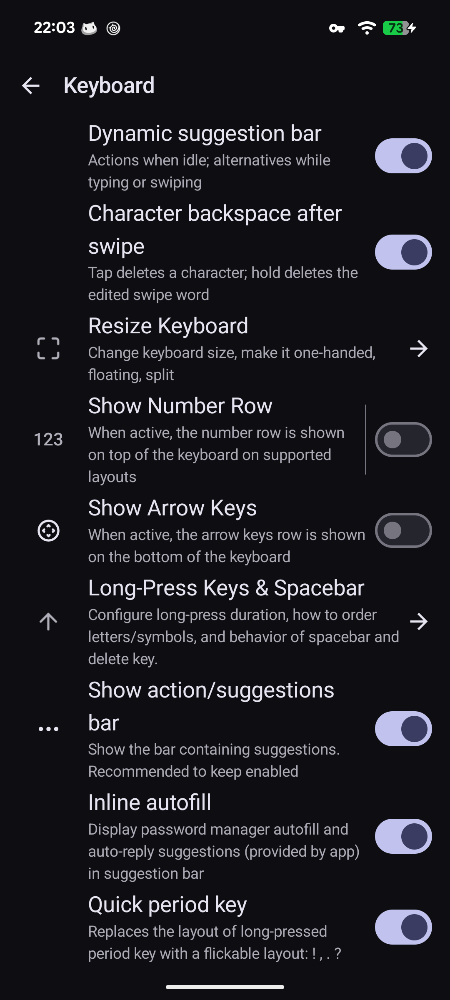
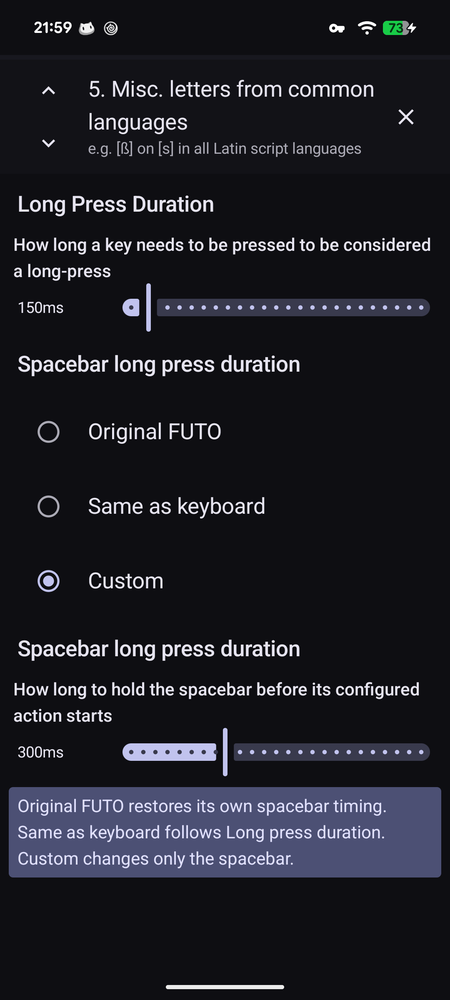

# FUTO Keyboard Enhancements

Six independent [Morphe](https://github.com/MorpheApp/morphe-manager) patches for
[FUTO Keyboard](https://github.com/futo-org/android-keyboard) and
[RUTO Keyboard](https://github.com/MisterFenek/ruto-keyboard): remote dictation,
a shared action/suggestion row, Android layout switching, and a few typing fixes.

This patches an existing APK. It does not build a fork of FUTO, rename its package,
or require an always-on Xposed module.

> **Vibe-coded, openly.** This is an AI-assisted hobby project built with Codex.
> APK inspection, automated tests and checks on a real phone are part of the work;

## The patches

Every patch is opt-in in Morphe. They can be applied individually or together.

| Patch | What it does |
| --- | --- |
| **Dynamic suggestion bar** | Shares one row between actions and suggestions. Keeps swipe alternatives accessible after a gesture. |
| **Remote speech backends** | Adds OpenRouter, Whisper ASR Webservice and custom OpenAI-compatible transcription. Requires [INTERNET and normal installation](#remote-speech-and-internet-permission); root mount does not work. |
| **Android IME layout subtypes** | Exposes enabled FUTO layouts in Android's keyboard picker and synchronizes language switches. |
| **System spell checker** | Allows Android's selected spell checker while FUTO is active. It does not supply a spell checker. |
| **Spacebar long press duration** | Adds stock timing, synchronization with the letter delay, or a separate slider in milliseconds. |
| **Character backspace after swipe** | Lets you delete characters and finish a swipe word by tapping, without first entering a space. Holding deletes the edited word. |

Settings live in FUTO's existing **Keyboard & Typing** and **Voice Input** menus.
Spacebar timing is under **Long-Press Keys & Spacebar**. Dynamic behavior and
character backspace have runtime switches; remote audio requires explicit consent.

<details>
<summary>A look at the keyboard settings</summary>

| Character deletion after swipe | Spacebar timing |
| --- | --- |
|  |  |

</details>

## Compatibility

- **Packages:** `org.futo.inputmethod.latin.playstore` (FUTO) and
  `org.futo.inputmethod.latin.unstable` (the inspected RUTO release).
- **Tested baseline:** FUTO `0.1.30-playstore`, version code `11751`.
- **Device checks:** Pixel 8, Android 17 / API 37.
- **Manager checks:** Morphe Manager 2.5.0, embedded Patcher 2.3.0.

Versions are deliberately **not pinned**. You can try another Play Store release;
the patches check the methods, fields and instruction flows they need and stop
when those structures do not match. This is not universal compatibility.
The base `org.futo.inputmethod.latin` package and F-Droid variants are outside
the declared target.

### RUTO

All six patches also target the APK linked by RUTO's README as
`futo-keyboard-ru-1.0.2.apk`. Its actual manifest declares **1.0.1-ru-unstable**,
version code **101**, package **org.futo.inputmethod.latin.unstable**. The filename
is not the app's internal version. See [RUTO adaptation](docs/ruto.md) for the
inspected hash, compatibility changes and test scope. Basic RUTO checks were also
performed on Pixel 8 / Android 17. Its Russian model exposed an upstream native
crash, reproduced without these patches and resolved by repairing one GGUF
feature flag. See [Native crash diagnosis](docs/ruto-native-crash.md) before using
the inspected Russian model. Historical FUTO results do not certify every RUTO flow.

Apply the same bundle in Morphe Manager, or use Docker:

```sh
make patch APK=.local/ruto/ruto-1.0.2.apk OUTPUT=build/dist/ruto-patched.apk
```

Native libraries, language models and original assets are preserved byte for byte
by the tested patch combinations. This bundle adds no language-model replacement.

## Build

You need Docker with Compose and Make. The Linux x86-64 image also runs through
Docker's emulation on ARM hosts.

```sh
make image
make test
make build
```

The bundle is written to `build/dist/futo-enhancements-<version>.mpp`.
For a bundle, source archive and SHA-256 checksums:

```sh
make release
```

The image downloads a pinned Kotlin compiler, Android SDK/build tools, Morphe CLI
and test JSON library from upstream, checking their SHA-256 sums. They are not
vendored here. Synthetic English/Russian test audio is generated with eSpeak NG
during the build; no recordings or downloaded speech files are stored in the repo.

If you prefer direct commands, every Make target is a thin wrapper around
`docker compose run --rm dev ...`. Agents can use the same image and commands
through Docker MCP; see [Development](docs/development.md).

## Apply to an APK

**Original APKs are not included.** Obtain an unpatched FUTO Play Store build or
the RUTO APK linked by its author. Split APKs must be merged first; [APKEditor](https://github.com/REAndroid/APKEditor)
is one upstream tool for that job.

Import the MPP as a local source in Morphe Manager, select the original APK, then
choose the patches you want.

### Remote speech and Internet permission

> **Remote Whisper/STT requires INTERNET, which the stock FUTO APK does not request.
> Morphe root mount is not suitable for this patch.**

The remote speech patch adds `android.permission.INTERNET` to the Manifest.
Android must register it through a **normal APK installation**. Root mount only
overlays the APK; it keeps the stock app's existing permission registration and
does not grant the added permission. This applies to OpenRouter, Whisper ASR
Webservice and custom remote transcription servers.

To keep the official installation and use remote speech, choose one of these routes:

- **Update the existing app with signature verification bypassed.** The patched
  APK has the patcher's signing identity, so an ordinary update over the official
  APK is rejected unless the device accepts that different signature. Use standard
  installation in Morphe, with the device's signature-verification bypass enabled.
- **Install a clone under a different package name.** This is a separate app and
  receives the declared permission on installation. Patch the supported original
  package first, then use a separate cloning/repackaging tool; this bundle does
  not implement package renaming. The clone does not automatically share the
  original app's settings or credentials.

Keep the patcher's signing key for subsequent updates. Do not uninstall your
existing keyboard as an automatic fix for a signing conflict.

### Desktop patching

For desktop patching, put your APK in the ignored local directory:

```sh
mkdir -p .local/apks
# Copy your original APK to .local/apks/futo-playstore.apk.
make patch
```

This selects all six patches and produces `build/dist/futo-patched.apk`.
Choose a subset with the wrapper directly:

```sh
docker compose run --rm dev python3 scripts/apply.py \
  .local/apks/futo-playstore.apk build/dist/spell-only.apk \
  --patch 'System spell checker'
```

The wrapper checks the package, stages output, and publishes it only if Morphe
reports every requested patch as successful. Existing output files are never
overwritten. Use `--unsigned` when you intend to sign the result yourself.

Local Morphe signing state lives in `.local/morphe-data/`, outside version control
and release archives. `make clean` removes build output and leaves it alone.

## Test

`make test` runs offline JVM tests for speech protocols, cancellation/error
handling, the dynamic row, swipe editing and spacebar timing. No account, API key,
microphone or phone is required.

For real Morphe patching against your own original APK:

```sh
make integration APK=.local/apks/futo-playstore.apk
```

The matrix covers individual patches, combinations, synthetic version changes
and incompatible targets. Synthetic version changes test the absence of a version
gate; they do not certify another real release.

The optional Android harness and live ASR checks are documented in
[Testing](docs/testing.md). CI builds the bundle and runs offline tests; it does
not download a FUTO APK or make paid API requests.

## How it is organized

```text
patches/       Kotlin Morphe patches and structural target checks
extensions/    Java code injected into the patched app
scripts/       Build, patching, inspection and release tools
tests/         JVM tests, Android stubs and optional device harness
docs/          Architecture, setup, test scope and limitations
.local/        Ignored APKs, signing state and private notes
build/         Ignored generated output
```

Start with [Architecture](docs/architecture.md) for the hook boundaries,
[Limitations](docs/limitations.md) for what is still unverified, or
[Contributing](CONTRIBUTING.md) to work on the code.

## Upstream and licensing

This is an independent project, not an official FUTO or Morphe release.
FUTO APKs, third-party source trees and tool binaries are not redistributed here.
See [Third-party tools](THIRD_PARTY.md) for their sources and versions.

This project's original patch code is licensed under the [WTFPL v2](WTFPL).
Upstream projects retain their own licenses.
